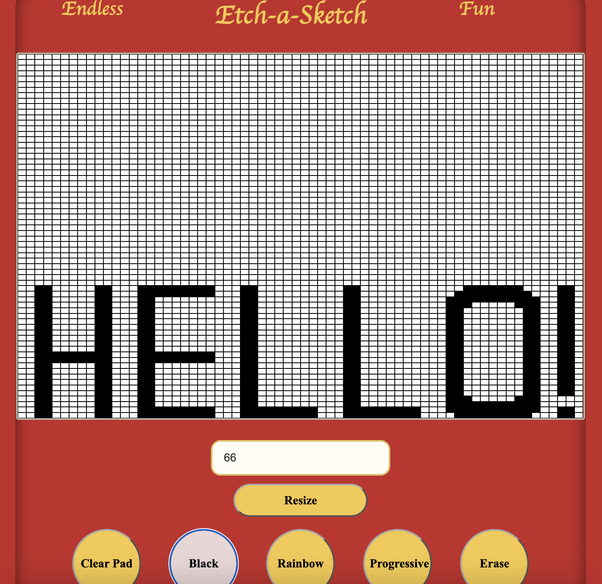

Etch-A-Sketch

- A browser-based Etch-a-Sketch drawing application built with HTML, CSS and JavaScript.
- Inspired by the classic drawing toy, this project allows users to create pixel-style drawings using an interactive grid.
- Developed as part of The Odin Project Foundations curriculum.

Live Demo:

https://zoojoy.github.io/etch-a-sketch/

Features :

- Interactive drawing grid.
- Adjustable grid size (from 2×2 to 100×100).
- Black drawing mode.
- Rainbow mode with randomly generated colours.
- Progressive darkening mode.
- Eraser functionality.
- Dynamic grid generation based on user input.
- Responsive drawing area.

Built with :

- HTML5
- CSS3
- Java Script (Vanilla JS)

What I've learned : 
 
- DOM manipulation and dynamic element creation.
- Working with loops and event listeners.
- Handling user input and validating values.
- Using JavaScript functions to manage different drawing modes.
- Generating random RGB colours.
- Manipulating CSS properties through JavaScript.
- Implementing progressive colour changes.